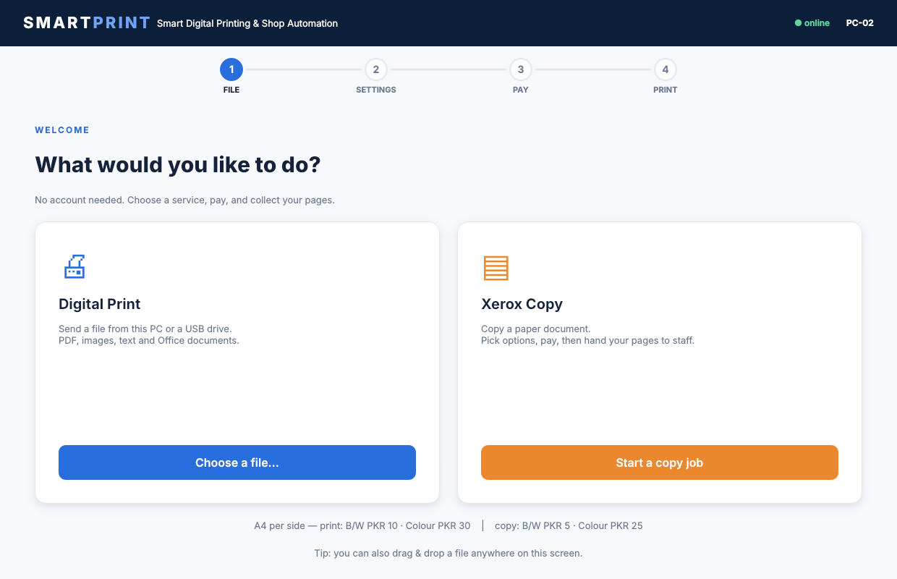
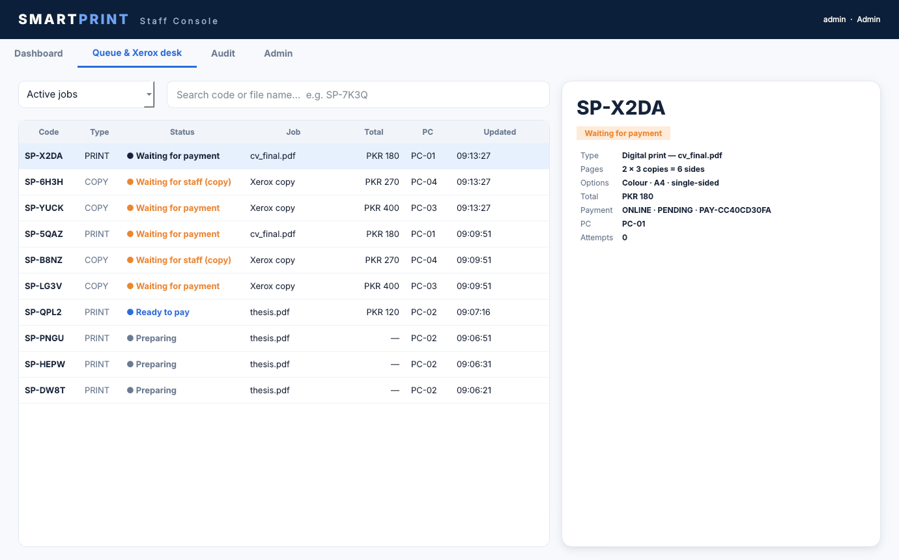
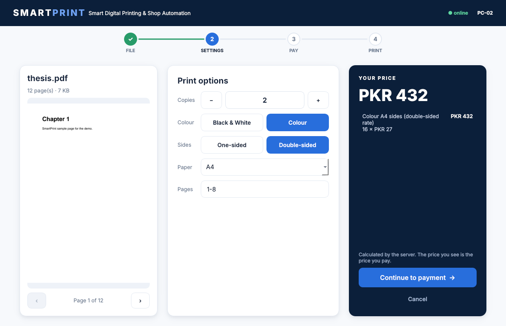
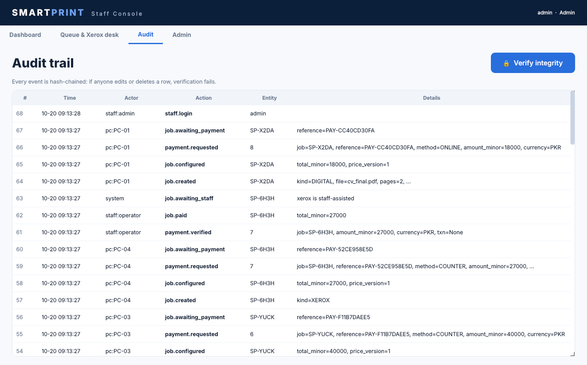

# SmartPrint — Smart Digital Printing & Shop Automation

A Python desktop system that makes digital printing **faster, controlled, transparent and less dependent on manual shop handling**.

**FILE → SETTINGS → PAY → PRINT.** No customer accounts. The server prices every job, verifies payment *before* production, queues the print, and audits every important event.

| Customer kiosk (PC-01…PC-04) | Staff console |
|---|---|
|  |  |
|  |  |

## Try it in 60 seconds
```bash
pip install -e ".[server,client,dev]"
smartprint-demo          # narrated, self-checking tour (19 checks) against a real server
```
Then the real apps:
```bash
smartprint-demo up                          # terminal 1: demo shop on :8000 (admin/admin12345, operator/operator12345)
SMARTPRINT_PC_NAME=PC-01 smartprint-kiosk   # terminal 2: customer screen
smartprint-staff                            # terminal 3: staff console
```
In the kiosk, "⚡ Demo: simulate customer paying" sends a correctly **signed webhook** through the real verification path.

## What it does (mapped to the slides)
| Slide | Delivered |
|---|---|
| Digital printing | Upload PDF/PNG/JPG/TXT/Office → validated, normalised to PDF, page-counted, previewed |
| Price calculation | Server-only, integer money, versioned price list, volume/duplex discounts, itemised lines |
| Payment | Online (provider adapter, HMAC-signed webhooks, replay-proof) or cash at counter confirmed by named staff |
| Print queue | Central state machine, single-use print authorisation, retries, per-job status |
| Staff control | Roles (operator/admin), cash confirm, retry, refund, price-list editor, PC registry |
| Xerox | Configure → price → pay → staff copies; automation only via a verified MFP adapter (none shipped) |
| Audit & recovery | Hash-chained audit log; crashed/unknown prints become `UNCERTAIN`, never lost or double-printed |
| Architecture | PySide6 clients → HTTPS/REST → FastAPI modular monolith → SQLAlchemy/Alembic → PostgreSQL; printer/payment/xerox adapters |

Full slide-by-slide evidence: [docs/TRACEABILITY.md](docs/TRACEABILITY.md). Design: [docs/ARCHITECTURE.md](docs/ARCHITECTURE.md). Deployment: [docs/OPERATIONS.md](docs/OPERATIONS.md).

## Layout
```
src/smartprint/shared/   vocabulary shared by server and clients (states, money formatting)
src/smartprint/server/   FastAPI app, models, services (jobs, payments, pricing, files, audit), adapters, worker
src/smartprint/client/   PySide6 kiosk + staff console
src/smartprint/demo.py   narrated acceptance tour
alembic/                 migrations          packaging/  PyInstaller build
tests/                   88 tests: unit, API, concurrency, recovery, security, migrations, headless GUI
```

## Quality gates
`make test` (SQLite) and `make test-pg` (PostgreSQL 16) both run all 88 tests, including headless GUI journeys and a migrations-vs-models drift check. CI runs both.

## Honest limits
* Real wallet/bank integration is one adapter class (`PaymentProvider`); only a **mock** provider ships.
* `SumatraPrinter` (Windows) and `CupsPrinter` have unit-tested command construction but need a one-time check on the shop's real printer.
* Xerox is staff-assisted; no MFP integration is bundled.
