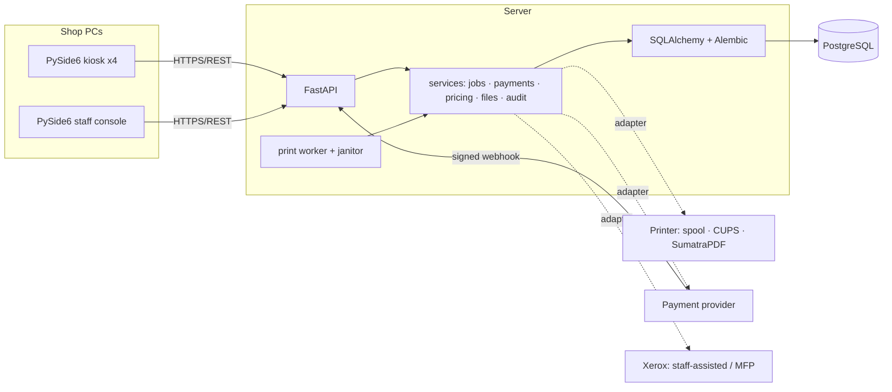
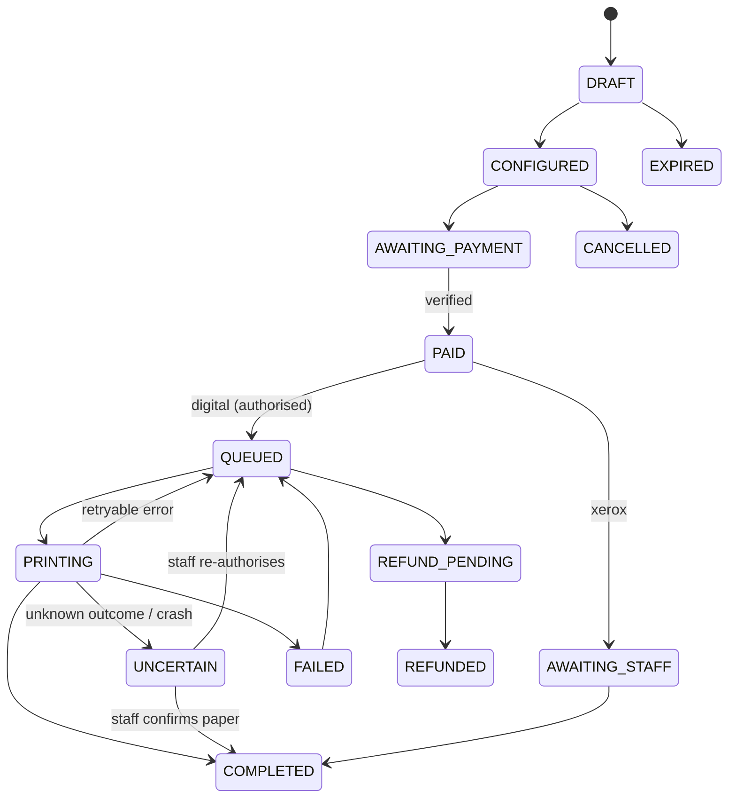

# Architecture

Modular monolith: one deployable server, clear internal modules, room to split later.

## Job state machine (`services/jobs.py`, `TRANSITIONS`)

## Key decisions
* **Server owns money.** Clients never send prices; settings freeze once payment is requested; money is integer minor units.
* **Verify, then authorise.** Payment verified → HMAC-signed single-use print authorisation bound to file hash + settings + amount. The worker refuses tampered files or replayed authorisations.
* **Never guess about paper.** If the printer outcome is unknown (timeout, crash, lease expiry) the job is `UNCERTAIN` and waits for a named human — no silent reprint, no silent loss.
* **Idempotent everywhere.** Webhook event ids are processed once; payment requests honour `Idempotency-Key`; optimistic locking (`version_id`) + `FOR UPDATE SKIP LOCKED` prevent double claims.
* **Tamper-evident audit.** Each event hashes the previous one; `GET /staff/audit/verify` pinpoints the first edited row.
* **Privacy.** No customer accounts; job access needs a secret per-job token (stored hashed); wrong token and missing job look identical.
* **Adapters** keep hardware/provider specifics out of business rules (Protocols in `server/adapters`).
